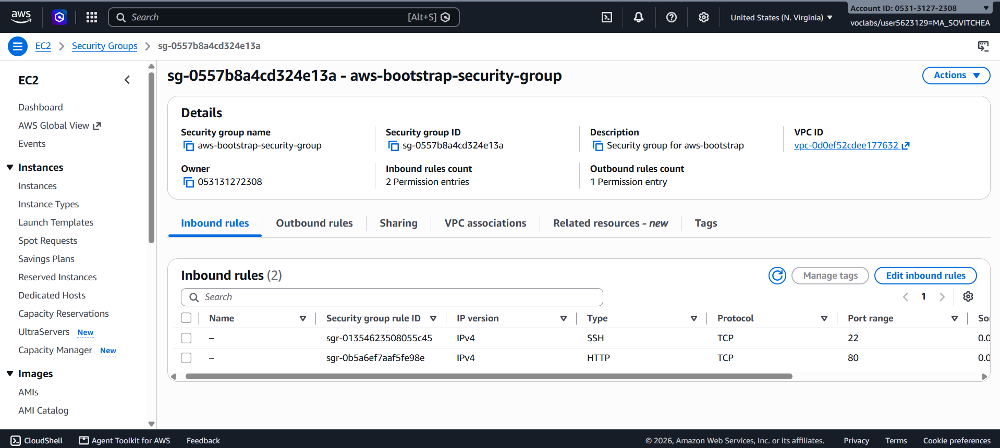
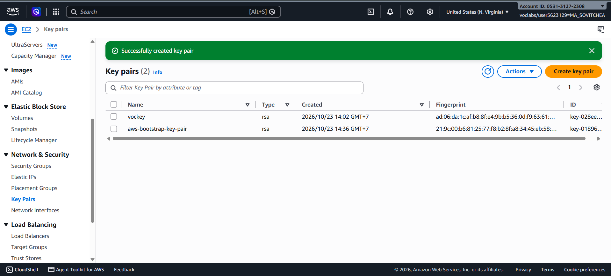
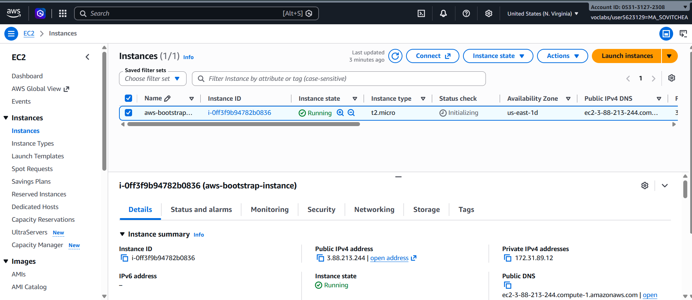
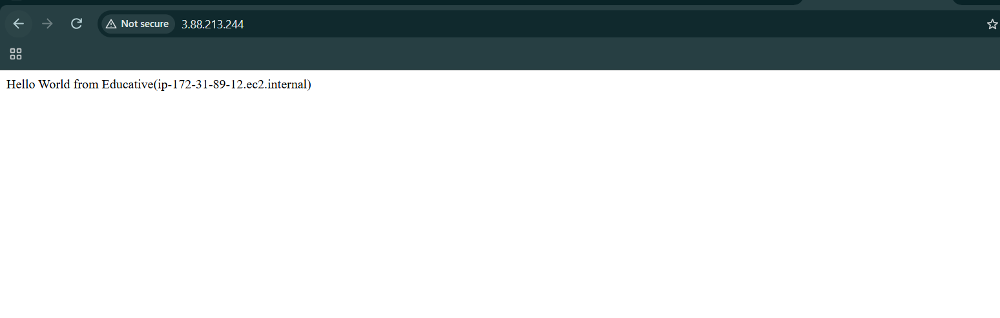
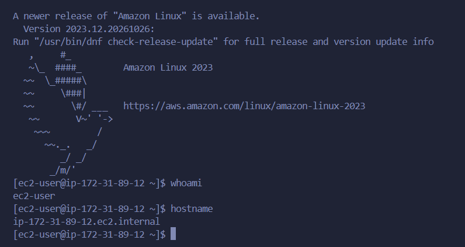
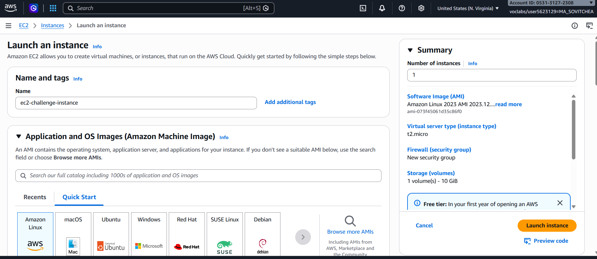
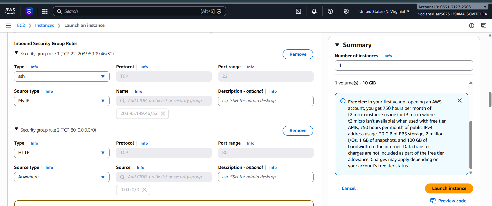
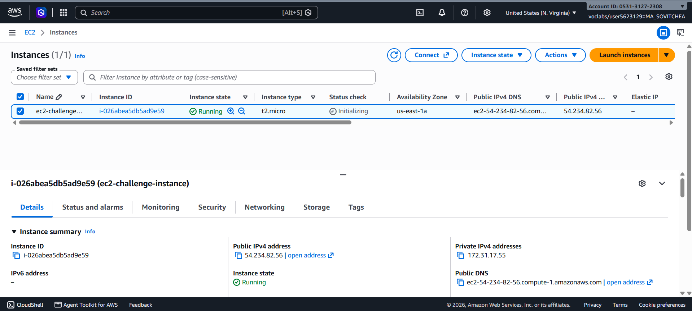
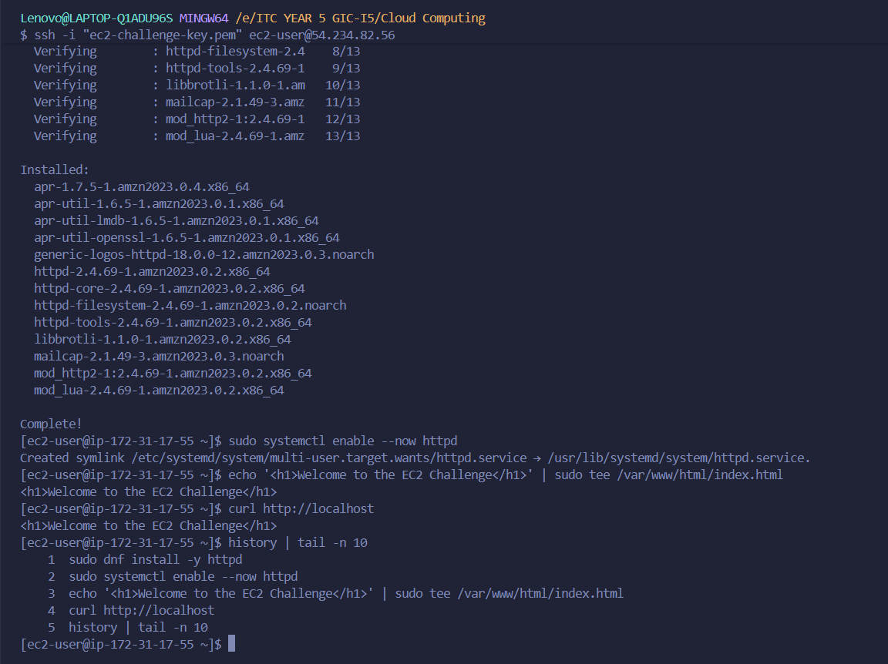
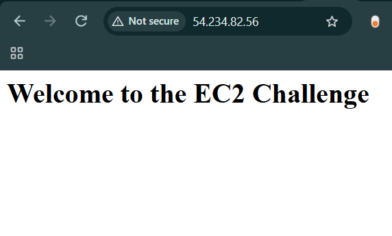

# Cloud Lab 1 Submission — Amazon EC2

- **Student name:** MA Sovitchea
- **Student ID:** e20221575
- **Learner Lab user name:** voclabs/user5623129=MA_SOVITCHEA
- **Date completed:** 30/Oct/2026

---

## Part 1.1 — An Amazon EC2 Walkthrough

### Security group



### Key pair



### Instance details



### Browser test



### SSH connection



Did you connect with your own SSH client or with EC2 Instance Connect?

**Answer:** I connected using my own SSH client through Git Bash with my downloaded `.pem` key.

---

## Part 1.2 — EC2 Web Solution (Challenge)

### Launch configuration



### Security group



### Running instance



### Commands on the instance



I ran these commands to install Apache, start the service, create `index.html`, and test the page:

```bash
sudo dnf install -y httpd
sudo systemctl enable --now httpd
echo '<h1>Welcome to the EC2 Challenge</h1>' | sudo tee /var/www/html/index.html
curl http://localhost
```

### Browser test



---

## Questions

1. Your security group has an SSH rule and an HTTP rule. What does each one let you do? What would stop working if you deleted the HTTP rule?

   **Answer:** SSH lets me connect remotely to the instance on port 22. HTTP lets people access the website on port 80. If I deleted the HTTP rule, the website would no longer be accessible from a browser through HTTP.

2. In Part 1.1 you never logged in to install the web server. What installed it, and when did it run?

   **Answer:** The user data script automatically installed and started Apache when the instance booted for the first time. It also created the web page.

3. Why does the web page open with `http://` but not with `https://`?

   **Answer:** I only configured HTTP on port 80. HTTPS requires a TLS certificate, HTTPS configuration on the server, and a security group rule allowing port 443.

4. Part 1.2 asked for a 10 GiB root volume. Where in the launch settings did you set it, and how can you check the size on the running instance?

   **Answer:** I set the root volume to 10 GiB under Configure storage before launching the instance. I can check its size by running `lsblk` through SSH or checking the attached EBS volume in the EC2 console.

## Problems and how I solved them (optional)

I accidentally deleted the default outbound rule. I restored it by adding an All traffic rule with destination `0.0.0.0/0`.

## AI note (optional)

AI suggested testing the web server with `curl http://localhost`. I ran the command and checked that it returned my welcome message. I also opened the public IP in my browser to confirm external access.

## Clean up

- [x] Part 1.1: instance terminated, key pair and security group deleted.
- [x] Part 1.2: instance terminated, security group and key pair deleted.