# Cloud Lab 2 Submission — Load Balancer and Auto Scaling

- **Student name:** MA Sovitchea
- **Student ID:** e20221575
- **Learner Lab user name:** voclabs/user5623129=MA_SOVITCHEA
- **Date completed:** 02/Nov/2026

---

## Security groups

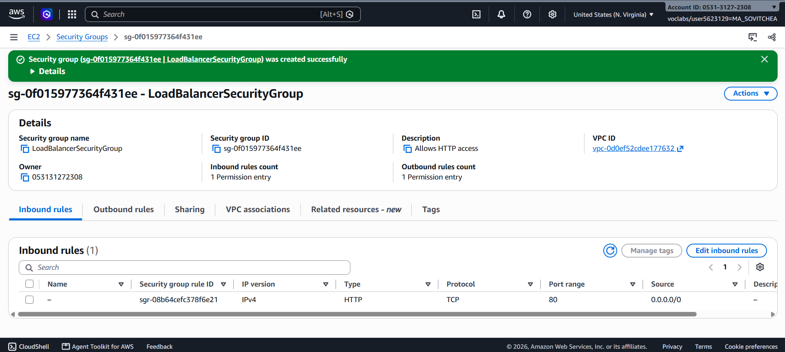

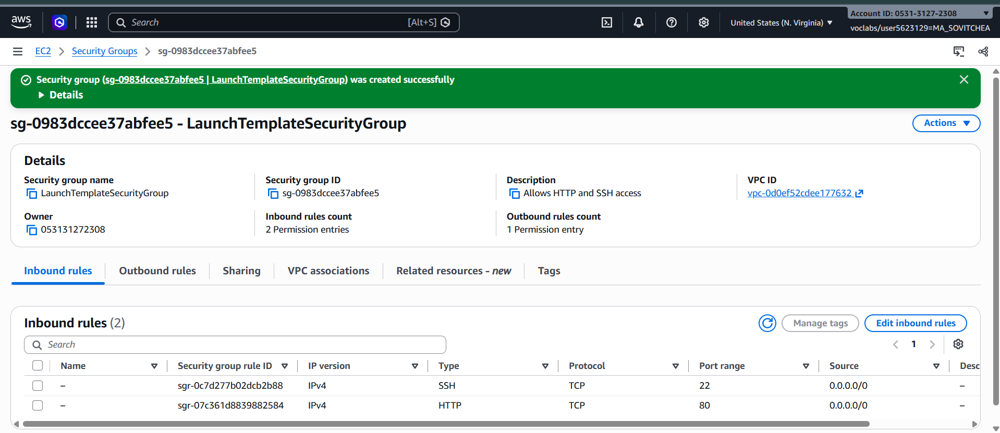

## Target group

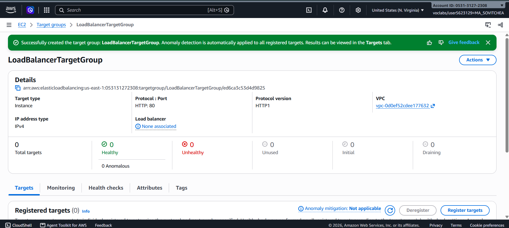

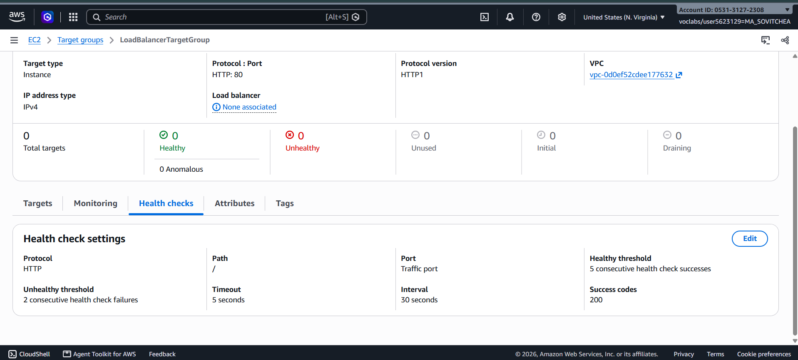

## Application Load Balancer

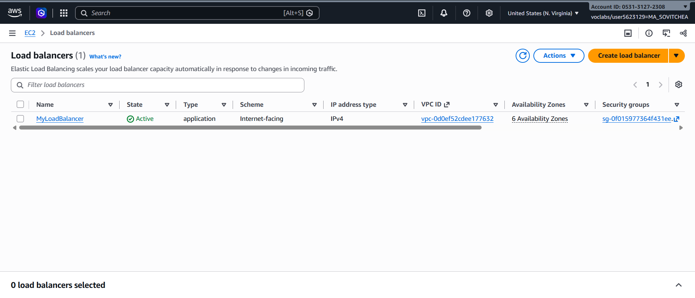

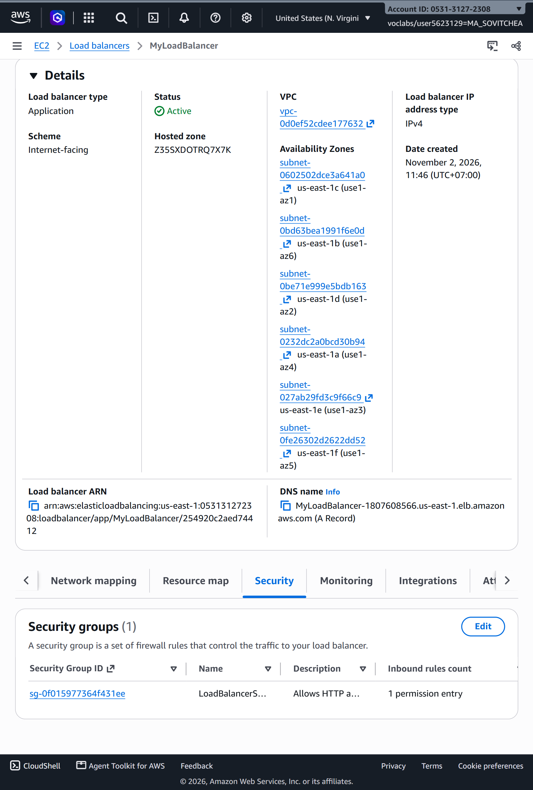

## Launch template

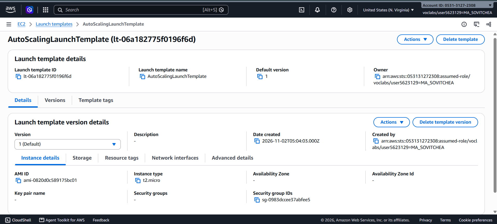

## Auto Scaling group

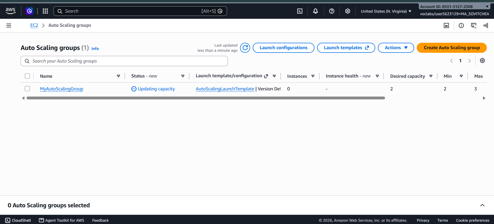

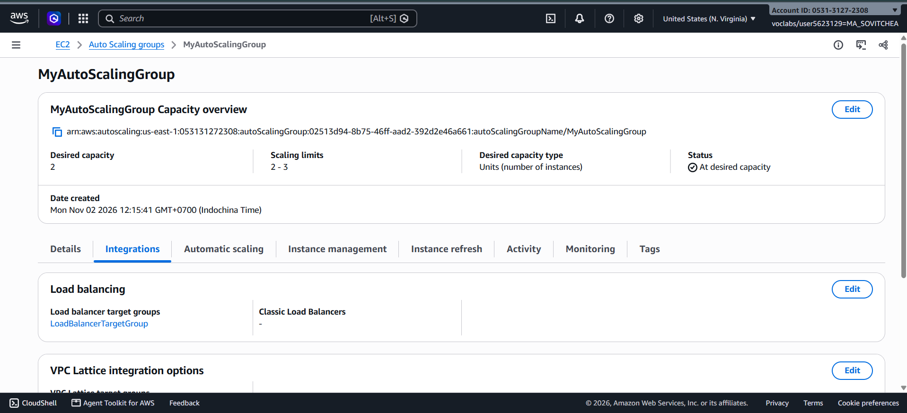

## Load balancing test

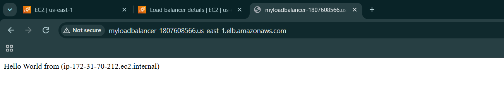

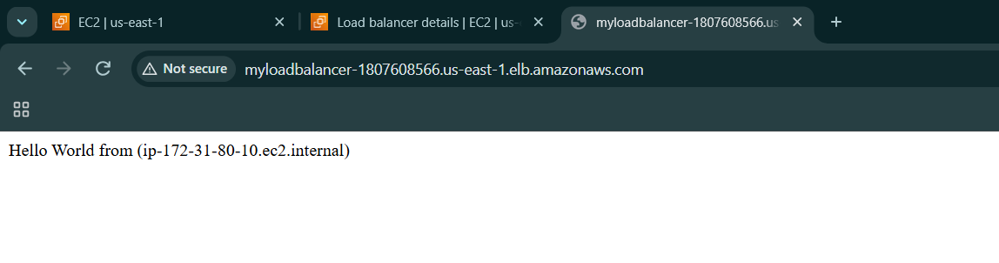

## Simulated application failure

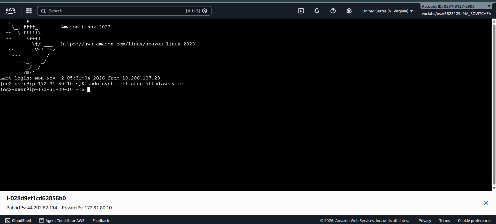

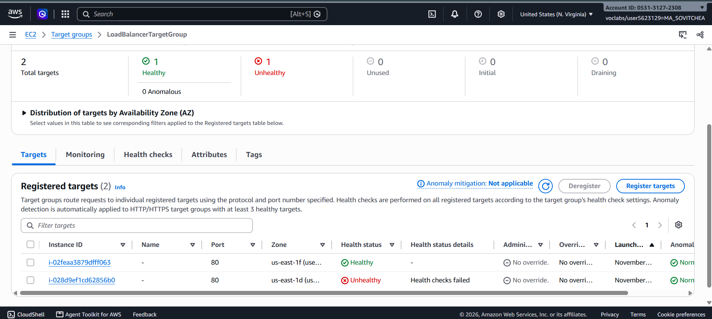

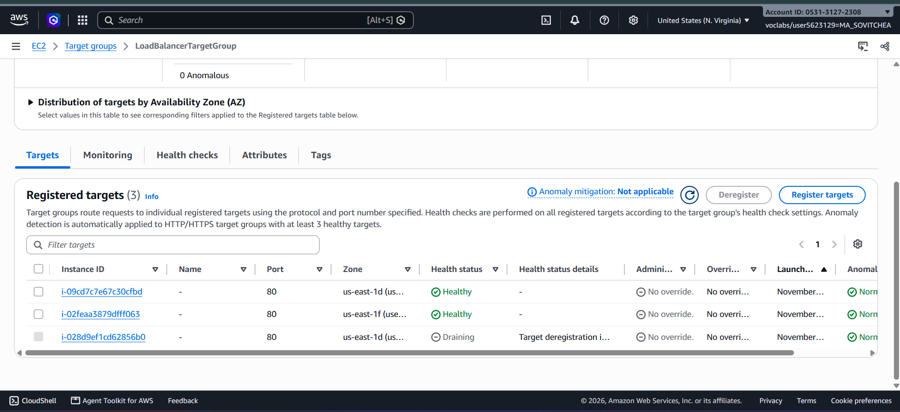

**About how many minutes passed between stopping `httpd` and the new instance becoming healthy?**

About 5 minutes, based on when I took the screenshots.

---

## Questions

### 1. Why does the page show a different host name when you refresh it?

The load balancer distributes requests between the two EC2 instances. Each instance displays its own hostname, so the hostname can change when I refresh.

### 2. After you stopped `httpd`, the instance was still running in EC2, but the target group marked it unhealthy. What did the health check test, and why did the instance fail it?

The health check sent an HTTP request to port 80 at the path `/` and expected a response code of 200. After I stopped Apache, the web server could no longer respond, so the health check failed even though the instance was still running.

### 3. Who replaced the failed instance? Explain the role of each one.

The Auto Scaling group replaced the failed instance.

- **Load balancer:** Distributes web requests to healthy targets.
- **Target group:** Groups the targets and defines the health checks used by the load balancer.
- **Auto Scaling group:** Uses the enabled ELB health checks to detect unhealthy instances and replace them while maintaining the desired capacity.

### 4. With desired 2, minimum 2 and maximum 3, how many instances run normally? In what situation could there be 3?

Normally, 2 instances run. There could be 3 if I increased the desired capacity to 3 or configured a scaling policy that increased it. The maximum of 3 does not automatically launch a third instance.

### 5. How could you change the security group so that the instances accept HTTP only from the load balancer?

In `LaunchTemplateSecurityGroup`, I would change the HTTP rule's source from `0.0.0.0/0` to `LoadBalancerSecurityGroup`. This would allow HTTP traffic only from network interfaces associated with the load balancer's security group.

## Problems and how I solved them

During cleanup, `LaunchTemplateSecurityGroup` could not be deleted while the Auto Scaling group was still deleting. I waited for the instances to terminate and then deleted the security group.

## AI note

An AI tool suggested refreshing the load balancer's webpage to see a different hostname. I checked this by opening the same address and observing two different hostnames after refreshing.

## Clean up

- [x] `MyAutoScalingGroup` deleted and its instances terminated.
- [x] `AutoScalingLaunchTemplate` deleted.
- [x] `MyLoadBalancer` and `LoadBalancerTargetGroup` deleted.
- [x] Both lab security groups deleted.