# Cloud Lab 4 Submission — Amazon VPC

- **Student name:** MA Sovitchea
- **Student ID:** e20221575
- **Learner Lab user name:** voclabs/user5623129=MA_SOVITCHEA
- **Date completed:** 11/Nov/2026

---

## VPC and internet gateway

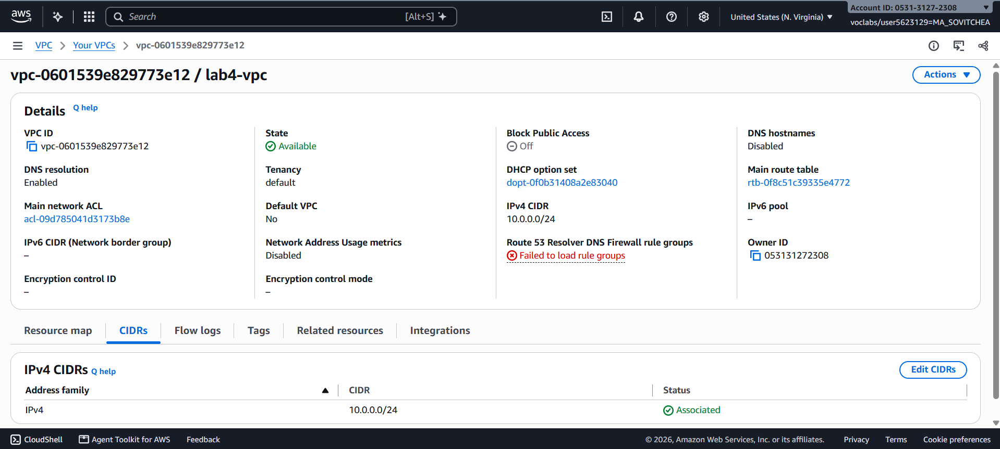

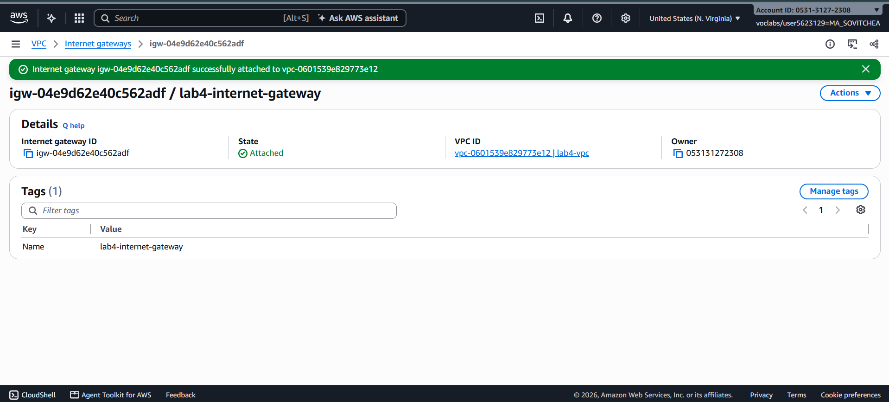

## Public subnet

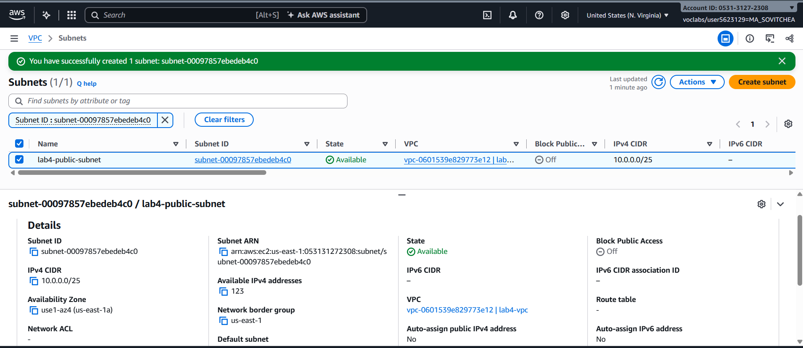

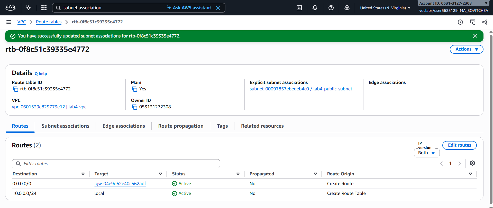

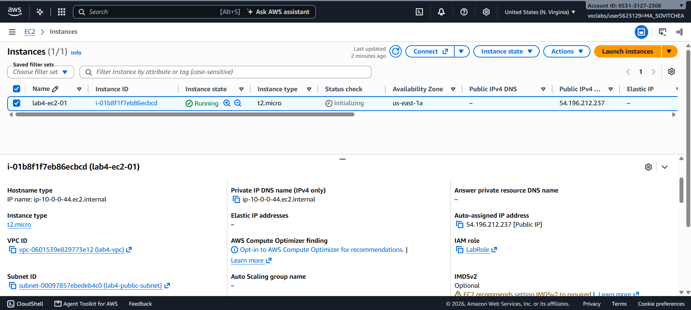

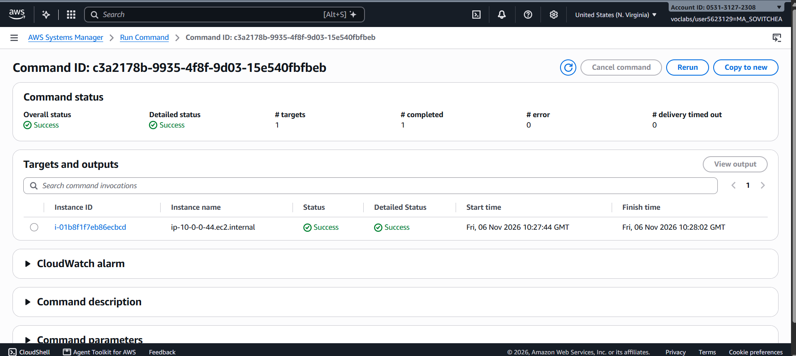

## Private subnet

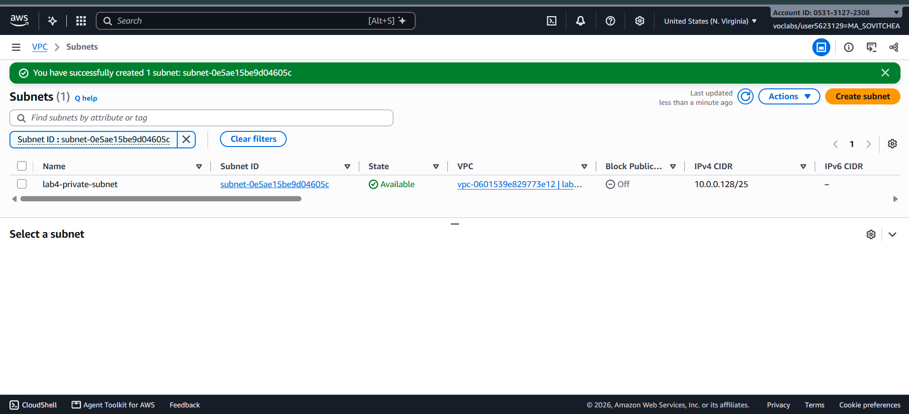

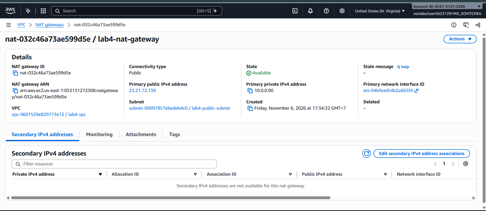

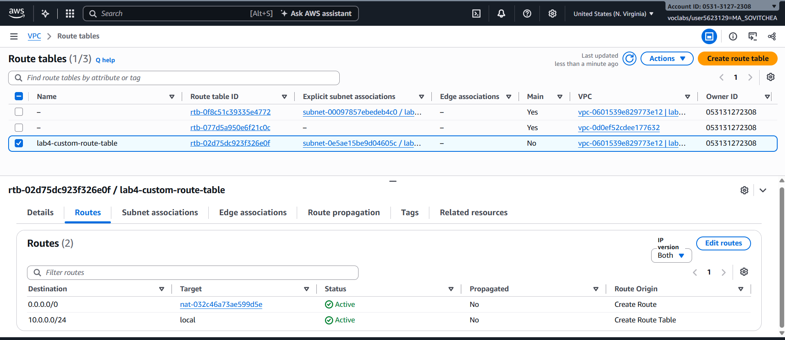

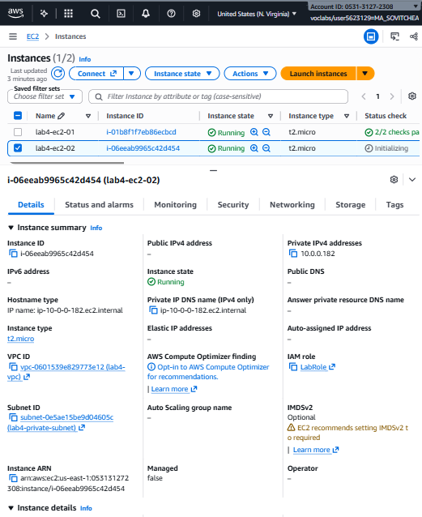

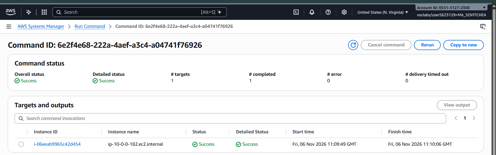

---

## Questions

1. The VPC is `10.0.0.0/24` and the subnets are `10.0.0.0/25` and `10.0.0.128/25`. How many IP addresses does each block contain, and why do the two subnets not overlap?

   The VPC has 256 IPv4 addresses in total. Each /25 subnet has 128 addresses. The public subnet covers `10.0.0.0` through `10.0.0.127`, and the private subnet covers `10.0.0.128` through `10.0.0.255`. The ranges share no addresses.

2. Both subnets are in the same VPC. What exactly makes `lab4-public-subnet` public and `lab4-private-subnet` private?

   The public subnet has a default route (`0.0.0.0/0`) to the internet gateway. The private subnet’s default route points to the NAT gateway, so instances there can reach the internet through NAT.

3. Why is the NAT gateway placed in the **public** subnet and not in the private one?

   The public subnet has a route to the internet gateway. The NAT gateway uses that route and its Elastic IP to send the private instance’s outbound traffic to the internet.

4. `lab4-ec2-02` has no public IP address. Can someone on the internet open a connection to it? Can it download updates? Explain both answers.

   Someone on the internet cannot initiate a direct connection to the instance because it only has a private IP address and the NAT gateway only handles connections initiated from inside the VPC. The instance can download updates because it can start an outbound connection through the NAT gateway and receive the replies.

5. You tested internet access with Systems Manager instead of SSH. Why did the instances need `LabInstanceProfile` for this?

   The instance profile gives the SSM Agent credentials through `LabRole`. The agent uses those credentials to register with Systems Manager, receive Run Command tasks, and report the results.

## Problems and how I solved them (optional)

I couldn’t find Amazon Linux 2 with Kernel 5.10 in Quick Start. I found the Amazon-owned `x86_64` gp2 image in Community AMIs and used it for both instances.

## AI note (optional)

An AI tool suggested checking Community AMIs for the required image. I checked that the owner alias was `amazon` and that the image listed Kernel 5.10, `x86_64`, and gp2 before selecting it.

## Clean up

- [x] Instances terminated.
- [x] NAT gateway deleted and its Elastic IP released.
- [x] Internet gateway detached and deleted.
- [x] `lab4-vpc` deleted.
